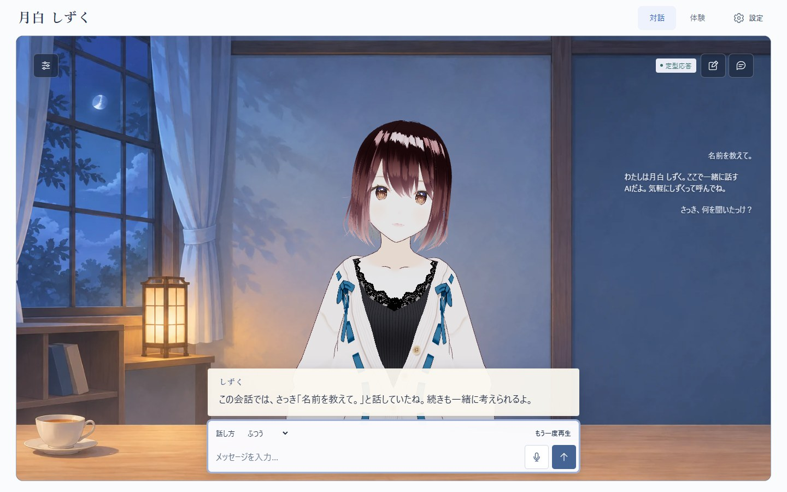
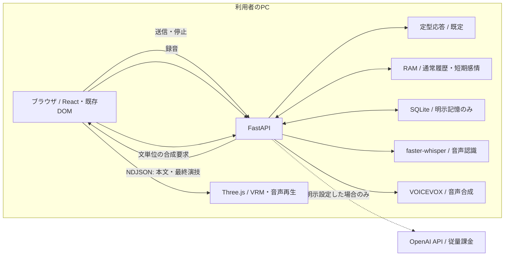

# Adaptive Character Lab

[](https://github.com/yutoo77/adaptive-vrm-dialogue-agent/actions/workflows/ci.yml)

**月白しずくと、声や文字で会話するローカル優先のAIアプリ。** 月明かりの部屋で向き合い、返答に合わせて声・表情・視線・口の動きが変わります。



2026-11-14、PR #18反映後の実画面（1440×900）。定型応答のMockで2往復し、VOICEVOX未接続のため文字で続けている場面です。表示モデルは **AvatarSample_A © pixiv Inc. / pixiv VRoid Project**。独自制作モデルではなく、モデル本体は同梱していません。

個人開発・就活ポートフォリオとして、会話の生成だけでなく、**途中で止める、音声が失敗しても続ける、保存する内容を選ぶ**ところまで実装しています。React / TypeScript・Three.js / VRM・FastAPIを使い、非同期処理と状態の境界を設計しました。

既定のMockはローカルLLMではなく定型応答です。実LLMとの会話はOpenAIへ明示的に切り替えた場合のみ利用できます。実APIの固定ケース評価と自動テストは実施済みですが、多様な会話の自然さや実マイクの精度は引き続き検証中です。公開Webサービスではなく、単一PC・単一利用者向けです。

## できること

- **しずくと話す。** 文字入力、または録音した音声を端末内で文字起こしして送信。「話し方」は「短め・ふつう・詳しく・やさしく」から選べます。現在のセリフを中心に表示し、長文や過去の会話は必要なときだけ開きます。
- **声と動きで返答を受け取る。** VOICEVOXの声・速さ・高さ・抑揚を調整でき、音声に合わせて5母音の口形と控えめな演技を再生します。音声入力は確認・修正してから送信し、読み上げに失敗しても文字の返答は残ります。
- **覚えておくことを自分で選ぶ。** 通常の会話はRAMで管理。「覚えておいて：…」または設定から明示登録した記憶だけをSQLiteへ保存し、確認・編集・削除できます。
- **別タブで一緒に謎を解く。** 体験「月待ちの便り」は、手掛かりを調べて小箱を開ける短い謎解き。配置・正誤判定・段階的ヒントはルールベースで、APIなしでも最後まで遊べます。AIが自律的に操作するAgentではありません。

操作と3分デモの流れは[デモガイド](docs/DEMO.md)、体験モードの分担と制約は[体験設計](docs/EXPERIENCE_DESIGN.md)にまとめています。

## 技術的に工夫したこと

### 1. 途中の返答と、保存済みの会話を分ける

生成を止めた直後に履歴へ保存されると、画面とサーバーの状態が食い違います。そこでFastAPI側で、**停止の受付と保存開始を同じロックで排他制御**しています。停止を受け付けた返答は通常履歴にも明示記憶にも追加せず、保存開始済みなら停止不成立として通知します。

表示はNDJSON（1行ごとのJSON）によるストリーミングです。生成中の構造化JSONから本文だけを取り出し、演技情報は最終検証後に確定します。途中表示は仮の状態として扱い、停止・失敗時に破棄します。競合時の非保存、分断された文字列、停止後の表示復帰をAPI・単体・ブラウザテストで確認しています。

[実装：生成・停止・保存の境界](backend/app/main.py) · [競合のテスト](backend/tests/test_api.py) · [停止の評価記録](docs/evaluations/natural-conversation-cancel-2026-08-25.md)

### 2. 音声を先に作りながら、順番と取消しを守る

全文の完成と音声合成を待つと、話し始めるまでが長くなります。閉じた文からVOICEVOXへ渡し、**合成待ちと再生待ちを別のキュー**で管理することで、前の文を再生中に次の文を合成できます。停止や最終本文の不一致では、未再生の音声・口形・予約したしぐさを破棄します。

口形はVOICEVOXの母音タイミングを実WAV長へ合わせ、音量で開口量を調整する5母音Lip Syncです。子音まで完全に再現するものではありません。順序・停止・古い非同期処理の無効化はテストで確認し、実OpenAI＋VOICEVOXの単発評価も記録しています。**既に聞こえた先行音声は取り消せない**点は、この設計の制約です。

[実装：音声キュー](frontend/src/speech/StreamingSpeechQueue.ts) · [順序と停止のテスト](frontend/src/speech/speech.test.ts) · [実音声の評価と計測条件](docs/evaluations/streaming-speech-2026-08-25.md)

### 3. 会話表示をReactへ移し、3Dと既存処理を再利用する

画面刷新で音声や3Dの状態まで作り直さないよう、Reactが所有する範囲を現在のセリフ・直近履歴・全文履歴に限定しました。入力や設定は既存のDOM制御に残し、同じ表示領域を二重に管理しません。`VRMViewer`はReactの再描画で作り直さず、生成・破棄の責務を分離しています。

ブラウザテストでは、対話と体験の切替で同じCanvasと各モードの下書き・履歴が保たれること、長文・生成待ち・停止・狭い画面で表示が成立することを確認します。PR #18では実VRMの目の高さからカメラ位置を決め、頭部を固定せず自然に向き合う構図へ調整しました。

[実装：Reactの表示境界](frontend/src/ui/DialoguePresentation.tsx) · [モード切替のテスト](frontend/e2e/experience.spec.ts) · [UI設計](docs/UI_DESIGN.md) · [カメラ・視線の比較記録](docs/evaluations/dialogue-eye-contact-2026-11-13.md)

### 4. 誤認識・保存・外部送信を、利用者が制御できるようにする

音声認識の結果は自動送信せず、編集中の下書きへ追記します。日本語変換中やモード切替後に遅れて届く結果も扱い、書きかけを壊さないようにしています。音声の失敗時には文字入力と返答を残します。

通常履歴はRAM内の直近10往復と決定的な要約、明示記憶だけがSQLiteです。実LLM・音声・定型応答はProvider境界で分け、外部送信は明示設定時だけ。演技も許可した感情・しぐさ・強度・最大2件の途中動作に制限し、任意のスクリプトや骨の操作命令は実行しません。感情の余韻は最大2往復だけRAMに残し、長期的な心理プロフィールにはしません。

[下書き保持の実装](frontend/src/transcription/VoiceDraft.ts) · [回帰テストと未確認点](docs/evaluations/voice-draft-preservation-2026-09-13.md) · [記憶と演技の設計](ARCHITECTURE.md)

## システム構成



APIキーはBackendの環境変数だけで扱います。OpenAI利用時は入力、直近履歴、要約、関連する明示記憶（最大3件）、固定のキャラクター設定などが送信対象です。体験タブの相談は通常対話・記憶とは分離しています。詳しいデータフローと責務は[ARCHITECTURE.md](ARCHITECTURE.md)、運用上の注意は[SECURITY.md](SECURITY.md)を参照してください。

## 技術スタック

| 領域 | 採用技術・役割 |
| --- | --- |
| 画面 | React 19・TypeScript 6・Vite 8。会話表示をReact化、入力・設定は既存DOM制御 |
| キャラクター | Three.js・`@pixiv/three-vrm`。VRMの描画、表情・視線・口形 |
| Backend | Python 3.12・FastAPI・Pydantic・HTTPX。入出力検証、非同期処理、Provider分離 |
| 対話・音声 | 定型Mock / 任意のOpenAI Responses API、ローカルVOICEVOX、faster-whisper |
| 保存 | 通常会話はRAM、明示記憶はSQLite、声の設定はブラウザのlocalStorage |
| 品質確認 | Vitest・Pytest・Playwright、TypeScript・ESLint・Ruff、GitHub Actions・Gitleaks・依存監査 |

固定バージョンは[Frontend](frontend/package.json)と[Backend](backend/requirements.txt)を参照してください。実行時に外部CDNからUIを読み込む構成ではありません。

## Quick Start

まず無料の定型応答で試せます。

Windows 10/11、Git、Node.js 22.12以上の22系、Python 3.12（64-bit）、WebGL対応ブラウザを用意します。Node.js 22系とPython 3.12はCIでも使用しています。初回の依存取得にはネット接続が必要です。

```powershell
git clone https://github.com/yutoo77/adaptive-vrm-dialogue-agent.git
cd adaptive-vrm-dialogue-agent
.\setup.ps1
.\start_demo.ps1
```

表示された <http://127.0.0.1:5173/> を開き、「何ができるの？」と送ってみてください。停止は起動したターミナルで `Ctrl+C`。VRM・VOICEVOX・APIキーがなくても、代替の3D表示と文字対話を試せます。別のアプリがポート8000/5173を使用中なら起動を中止してPIDを案内し、自動終了はしません。

PowerShellでスクリプトがブロックされた場合は、内容を確認したうえで、その起動だけ `powershell -ExecutionPolicy Bypass -File .\setup.ps1` のように実行できます。端末全体の実行ポリシーを変更する必要はありません。

<details>
<summary>VRM・音声・実LLMを追加する</summary>

### VRM

利用条件を確認した `.vrm` を画面へドロップするか、`frontend/public/models/private/character.vrm` に配置します。この場所とVRMファイルはGit除外され、ビルドにもコピーされません。[モデルの利用条件記録](docs/model-license-record.md)も参照してください。

### 音声出力

[VOICEVOX](https://voicevox.hiroshiba.jp/)を起動し、ローカルの `http://127.0.0.1:50021/docs` が開くことを確認します。「設定 → 音声 → 音声出力」で声・速さ・高さ・抑揚を変更し、「声を試す」で確認できます。既定は冥鳴ひまり（ノーマル / ID 14）。選択はブラウザに保存し、次の発話から適用します。後からEngineを起動した場合は「再接続」を使います。

### 音声入力

`small`認識モデルを事前取得する場合は、リポジトリ直下で実行します（初回は約464MiB）。

```powershell
.\setup.ps1 -PrepareTranscriptionModel
.\start_demo.ps1 -PrepareVoiceInput
```

`-PrepareVoiceInput`は取得済みモデルをBackendへ事前読込するだけで、録音・再ダウンロードはしません。録音はマイク操作後のみ、最大15秒です。認識結果を入力欄で確認してから送信します。初回準備後もCPU認識には数秒の待ちがあり、誤認識の修正が必要です。

### 実LLM（任意・有料）

起動中なら一度終了し、PowerShell 7でリポジトリ直下へ戻ってから次を実行します。起動スクリプトの終了後は作業場所が `frontend` へ移っている場合があります。キーをコマンド履歴へ直接書かず、入力を伏せて受け取ります。

```powershell
$env:DIALOGUE_PROVIDER = "openai"
$env:OPENAI_API_KEY = Read-Host "OpenAI API key" -MaskInput
.\start_demo.ps1
```

モデルなどの設定名・既定値は[backend/.env.example](backend/.env.example)を参照してください。**このアプリは `.env` を自動読込しません。** 必要な値は同じターミナルの環境変数として指定します。Mockへ戻すときは停止後に `$env:DIALOGUE_PROVIDER = "mock"` として再起動します。

OpenAI APIへの送信と従量課金が発生します。キーを `VITE_` 変数、Git、画面写真へ入れないでください。`store=False`はデータ保持ゼロを保証するものではなく、機微情報は送らないでください。

</details>

## 評価・テスト

**実装の回帰テストと、会話体験の評価を分けています。** 2026-11-14、PR #18取り込み後のmain（`94dab3d`）では、[GitHub Actionsの4ジョブが成功](https://github.com/yutoo77/adaptive-vrm-dialogue-agent/actions/runs/43552573386)しました。

| 確認 | 結果・範囲 |
| --- | --- |
| Vitest / Pytest | Frontend 212件、Backend 193件。状態遷移、ストリーミング、停止、音声、記憶など |
| Playwright | 47件。Mockでの対話・体験切替、下書き、設定、失敗復帰、PC / 狭い画面 |
| 静的検査・ビルド | 型検査、ESLint、Ruff、pip check、Viteビルドが成功 |
| 秘密情報・依存 | Gitleaks成功。11/14の実行依存監査はnpm `--omit=dev`・Backendとも検出0件。ただし開発依存を含むnpm監査には14件（high 3 / moderate 11）が残る |

CI成功は脆弱性ゼロを意味しません。開発依存には通常のローカル起動で使うViteも含まれるため、警告を無害とは扱っていません。今回は依存更新を行わず、別途修正・回帰確認する課題として残しています。

実API・音声の評価は、当時の条件と失敗例を含めて保存しています。

- [実OpenAI対話（2026-08-25）](docs/evaluations/real-openai-dialogue-2026-08-25.md)：架空の固定4往復。未知の会話全般や利用者満足度の評価ではありません。
- [文単位音声（2026-08-25）](docs/evaluations/streaming-speech-2026-08-25.md)：実OpenAI＋VOICEVOXの単発計測。WAV準備は6,142ms、全文後合成の比較値は9,019ms。可聴開始の実測や一般的な速度保証ではありません。
- [会話の口調（2026-09-06）](docs/evaluations/conversation-style-2026-09-06.md)：改善前後9件ずつと、最終自己紹介2件。最終設定で全9件の再測定は未実施です。
- [音声入力の遅延（2026-09-13）](docs/evaluations/transcription-latency-2026-09-13.md)、[カメラ・視線（2026-11-13）](docs/evaluations/dialogue-eye-contact-2026-11-13.md)：測定条件、採用判断、未確認点を記録。その他は[評価記録一覧](docs/evaluations/)へ。

<details>
<summary>ローカルで自動テストを実行する</summary>

リポジトリ直下から実行します。`-Development`はテスト依存とPlaywright用Chromiumを取得します。

```powershell
.\setup.ps1 -Development
.\.venv\Scripts\python -m ruff check backend
.\.venv\Scripts\python -m pytest backend\tests
.\.venv\Scripts\python -m pip check
.\.venv\Scripts\python -m pip_audit -r backend\requirements.txt
cd frontend
npm run check
npm run test:e2e
npm audit
```

ブラウザテストは専用ポート15173/18000と一時的な記憶領域を使い、所有者のSQLiteは開きません。録音の一部は模擬イベントを使い、CIにはVRM未配置時の代替表示も含まれます。実マイク、実端末の描画、声や表情の自然さは別途人が確認する必要があります。

</details>

## 制約と次の改善

- **会話・声の自然さ**：実LLMは限定ケースでの確認です。読み間違い、音声認識の遅さや雑音への弱さが残り、5母音の口形も近似です。多様な会話・実マイク・聴取の評価を優先します。
- **停止の限界**：既に再生した音声は戻せず、外部APIの計算・請求が即座に止まる保証もありません。保存開始後の停止は成功扱いにしません。
- **記憶と個人化**：SQLiteは暗号化していません。記憶検索は文字重なり方式で、意味検索ではありません。話し方は明示選択、短期感情の補正は限定的な日本語ルールです。
- **保守性・起動負荷**：React化は会話表示が中心。入力・設定などの`UIController`は整理の余地があります。JSビルドは約1.16MB（11/14）で、分割に関する警告も残っています。
- **未実装の範囲**：Toolを使うAgent、RAG、Vision、独自制作VRM、公開Webサービスは未実装。認証や利用者ごとの権限制御がないため、サーバーをインターネットへ公開しないでください。

次の優先順位と完了条件は[開発ロードマップ](DEVELOPMENT_ROADMAP.md)に整理しています。機能を増やす前に、既存の会話体験と失敗時の復帰を検証します。

## 詳細資料・ライセンス

- [設計と責務](ARCHITECTURE.md) / [作品の目的・設計判断](PROJECT_DIRECTION.md) / [UI設計](docs/UI_DESIGN.md)
- [デモの操作・復帰手順](docs/DEMO.md) / [評価記録](docs/evaluations/) / [セキュリティ](SECURITY.md)

ソースコードは[MIT License](LICENSE)。VRM・音声ライブラリ等の条件とは別です。[第三者ライセンスとクレジット](THIRD_PARTY_NOTICES.md)を確認してください。

画面のモデルはAvatarSample_A © pixiv Inc. / pixiv VRoid Project。背景は画像生成ツールで制作した室内画です。既定の音声を公開する場合のクレジットは `VOICEVOX:冥鳴ひまり`。モデル本体・音声ライブラリ・生成音声・個人の会話データは同梱していません。
