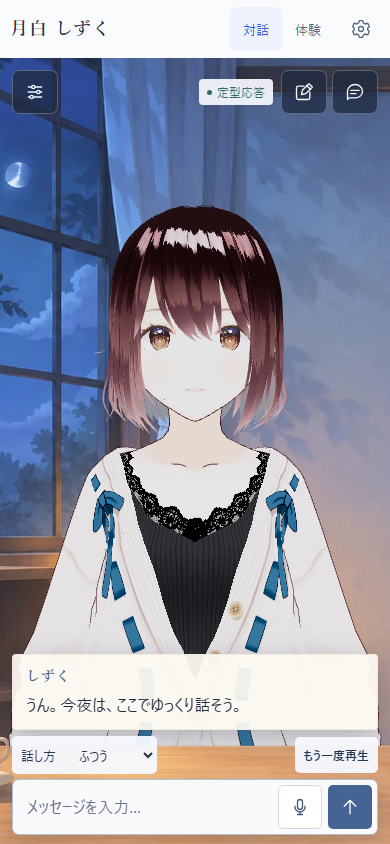
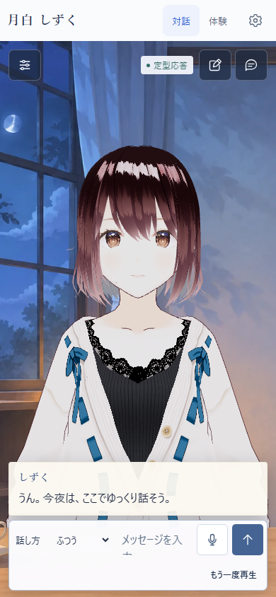
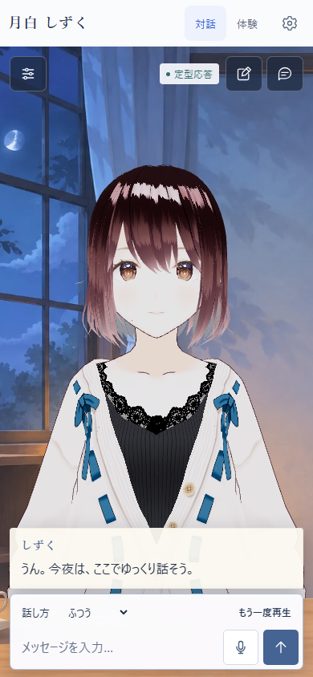
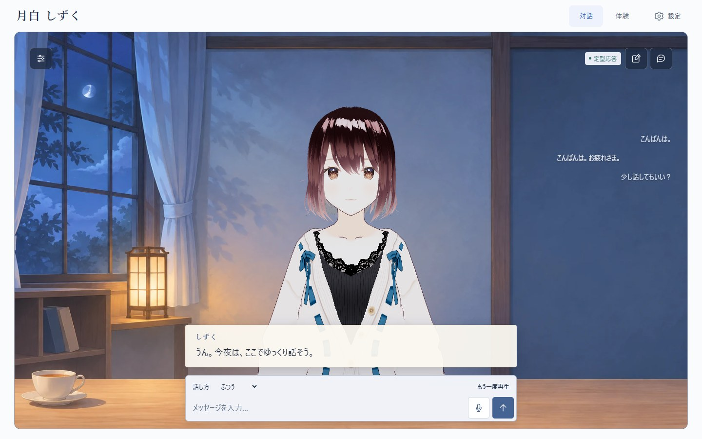
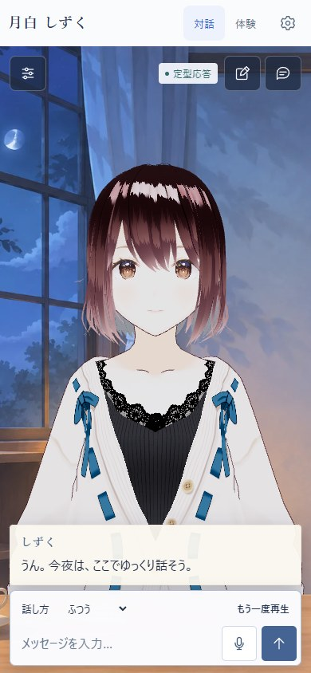
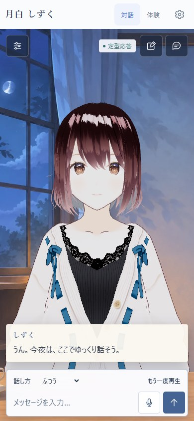
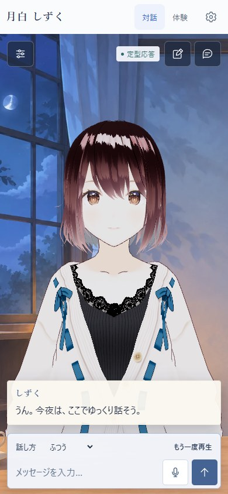

# 入力操作の配置 — 2026-11-14

基準はPR #20の`b143744`。話し方の選択と音声再生が入力欄から離れて見える点を調整した。背景・照明・カメラ・目線・履歴、対話や音声の処理は変更しない。

## 同条件での3案比較

1440×900 / 390×844、同じAvatarSample_A・中立姿勢・開眼で撮影。本文と再生状態は配置確認用の架空fixtureであり、実音声の成功例ではない。採用欄は試作だけでなく、実装後の画面を再撮影している。

| 現状 | 入力と同じ行に配置 | 入力に接する操作行：採用 |
| --- | --- | --- |
|  |  |  |
|  |  |  |

| 入力部分の実測幅 | 現状 | 同じ行 | 採用案 |
| --- | ---: | ---: | ---: |
| 1440×900 | 568px | 423px | 568px |
| 390×844 | 254px | 109px | 254px |

- **採用：接する操作行。** 入力欄の上段を補助操作にして、共通の背景と外枠でまとめる。文字サイズを下げず、セレクトと音声操作は44px以上の高さを確保する。入力面全体は99pxから95pxになり、入力部分の位置・幅・高さは維持できた。
- **不採用：同じ行。** PCでも話し方と文章の開始位置が競合し、スマホでは入力幅が109pxになり、プレースホルダーが折り返した。入力操作を犠牲にするため見送った。
- **不採用：現状維持。** 操作はできるが、話し方と再生の白い小さな部品が入力欄から離れた印象が残る。

## 操作と状態の境界

`composer-surface`は既存の操作行と送信フォームを囲む表示用の要素だけ。セレクト・再生ボタンはフォームの外に残し、DOM順序、ID、イベント、4種類の内部値を変更しない。選択や再生のEnter操作が送信へ化けることを防ぐ。ホバーなしでも「話し方」と現在値・再生操作が見える。

生成・録音中の無効化、生成停止、次の送信への話し方反映、設定・モード往復の下書きと選択保持は既存処理を使う。React表示の所有範囲、VRMインスタンス、Backendは変更しない。

## 画面確認とREADME

実VRMで短文・長文・初期表示・未接続・再生エラー・再生中、設定開閉、体験への切替と復帰を確認。両幅とも横はみ出しなし、入力と送信は画面内に収まる。通常対話のカメラ座標は前後とも`(0, 1.41409, 1.68634)`、照明も同一。体験は従来の画角と照明へ切り替わる。

READMEは現在の作品紹介として、通常のデモ説明と最新画像だけを冒頭に置く。PR番号、改修時点の説明、過去のテスト件数を前面に出さず、CIと評価記録へ詳細をつなぐ。Mock・VOICEVOX・サンプルモデルの事実や制約は残す。比較画像はこの資料にのみ掲載する。

## README画像の実音声確認

配置統合時の[README画像](https://raw.githubusercontent.com/yutoo77/adaptive-vrm-dialogue-agent/f0a25fa04f76a5a06f7f56af2b0903c20d1a8c2b/docs/assets/demo-overview.jpg)は1440×900の実アプリ画面。「こんばんは。」「名前を教えて。」「さっき、何を聞いたっけ？」という架空の3往復を、実BackendのMockとローカルのVOICEVOX Engine 0.25.2（冥鳴ひまり・ノーマル / ID 14）で実行した。画像用の応答差し替え、音声状態・姿勢・カメラの強制は行っていない。

- 合成9件はすべてHTTP 200、非ゼロの音声データを持つRIFF/WAVE、母音タイミングversion 1を確認。
- ブラウザの実Audioで`playing`と`ended`を各9回観測し、最終状態は`ready`。ページ例外・外部へのリクエストは0件。
- 撮影用ChromiumはNVIDIA GeForce GTX 1650 / ANGLE D3D11で描画。アプリの照明・カメラ・音声タイムアウト設定は変更していない。
- **途中の失敗もある。** 先行したソフトウェア描画での撮影2回は、VOICEVOXの約30秒タイムアウトにより中断した。片方は2文の再生後に失敗した。GPU描画への切替前には短文の合成も行っており、描画方式だけが原因だと切り分けたわけではない。今回の成功は連続運転の安定性や、人が聞いた音質の保証ではない。

## 自動検証

- `npm run check`：型検査・ESLint・Vitest 221件・ビルド成功。
- Backend：Ruff・Pytest 193件・`pip check`成功。Backendの変更はない。
- 追加のPlaywright 5ケースで、PC / スマホ幅の4種類の選択値と送信値、44pxの操作領域、生成停止、再生停止・再再生、設定・体験往復の下書き保持、誤送信防止を検査する。キーボードで選択値が変わることも確認対象。
- 初回のローカル全体実行では、2幅を一つにまとめた追加テスト2件が全体時間制限に達し、中断した。ケースを幅ごとに分け、停止観測用の2秒音声は維持しつつ最後の通常送信には320msのテスト音声を使う。個別再実行でも初回ページ表示や総時間制限で中断するケースがあり、ローカルの全体完走は未確認。
- `5177ad5`の[初回CI](https://github.com/yutoo77/adaptive-vrm-dialogue-agent/actions/runs/43570631120)は4ジョブ成功。ただしブラウザは58件が初回成功、設定・モード切替・再生の2件は60秒の総時間制限後に再試行で成功（flaky）した。これを全件初回成功とは扱わない。複数の実再生とモード往復を含むその2件だけ、総時間枠を90秒へ調整した。各状態の検査上限30秒、検査内容、2秒音声による停止観測は維持する。
- 最新の全体結果は[PRのCI](https://github.com/yutoo77/adaptive-vrm-dialogue-agent/pull/20/checks)を参照。自動テストの音声は生成した無音WAVであり、上記の実VOICEVOX撮影とは別。
- READMEと変更した資料のローカル参照58件に欠落なし。公開後のGitHub表示でも画像と詳細資料への導線を確認済み。画像のGitオブジェクトIDもローカルと公開ブランチで一致した。

人による音質評価、実マイク、スマホ実機のソフトキーボードは今回の確認範囲外。静止画の好みには利用者の確認を残す。

モデル：AvatarSample_A © pixiv Inc. / pixiv VRoid Project。[利用条件記録](../model-license-record.md)。モデル本体・生成音声・個人の会話データは追加していない。

## 追補：セリフと入力の余白

基準は`f0a25fa`。話し方・再生の一体化は採用済みとして維持し、二つの白い面が続いて見える点だけを比較した。同じ実VRM・開眼姿勢・架空の本文と音声状態を使い、1440×900 / 390×844で初期表示・短文・長文・再生中を確認。下の採用後画像は、CSS実装後に試作用の上書きなしで撮影した。

| 変更前 | 余白のみ：採用 | 余白＋入力の色・影：見送り |
| --- | --- | --- |
|  |  |  |
|  |  |  |

- **採用：間隔を8px増やす。** PCは8→16px、スマホは6→14px。間に背景が見えることで、セリフと入力を一続きのカードとして見せずに区別する。セリフ欄だけ8px上がり、顔・首には重ならない。
- **見送り：入力を青みのある白へ変え、影を弱くする。** 悪化は見られないが、余白だけの案に対する明確な改善がない。色・透明度・境界線・影・文字サイズは現状を維持する。
- 8状態すべてで、変更前後の入力部分の座標・幅・高さは一致（PC568×44px、スマホ254×44px）。横はみ出しなし。カメラ座標・照明も一致。長文の省略と全文表示、再生時の操作は維持する。
- 既存の操作テストに16px / 14pxの間隔検査を追加。4種類の話し方、送信・生成停止、音声停止・再再生、設定・体験往復の検査と時間枠は変更しない。Frontendの型検査・lint・単体221件・ビルド、BackendのRuff・193件・pip checkは成功。最終CI結果はPR本文の該当commitと実行リンクを参照。

READMEの文章は作品紹介のまま、メイン画像だけを撮り直した。短文1件の合成でEngineを確認した後、同じ架空の3往復を実Mock＋VOICEVOX 0.25.2 / 冥鳴ひまりで実行。今回の撮影は1回で完了し、WAV9件がHTTP 200、`playing` / `ended`各9回、最終`ready`、ページ例外・外部リクエスト0件を確認した。GPU描画を使用し、会話・音声状態・姿勢は差し替えていない。先行する節の撮影失敗・テスト再試行は過去の記録として残す。聴取や実スマホの評価は未実施。
