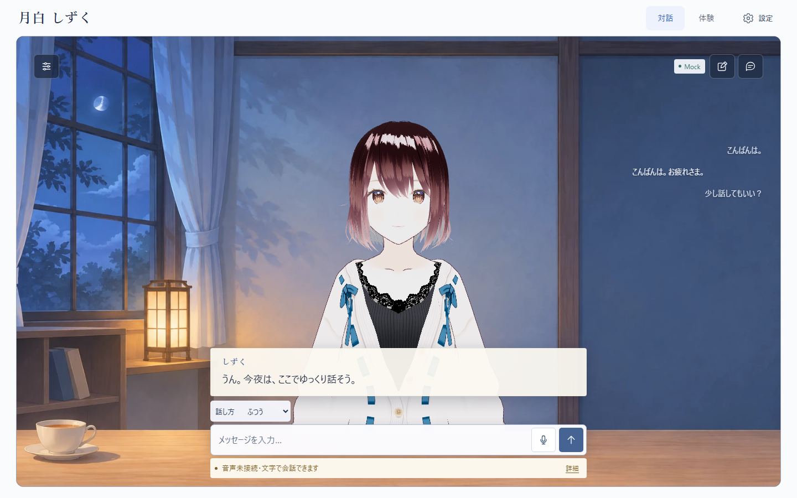
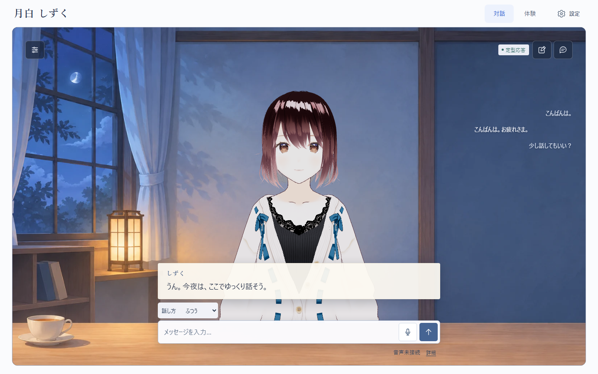
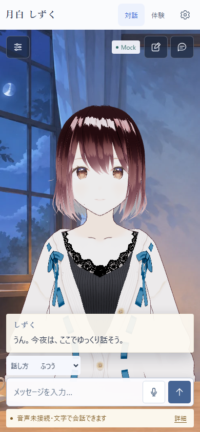
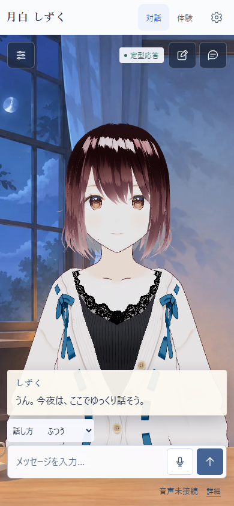
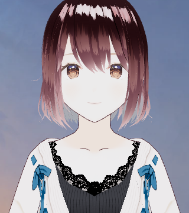
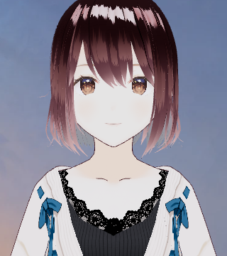
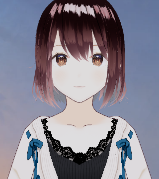

# 対話UIの仕上げ — 2026-11-14

基準はPR #17〜#19取り込み後のmain `de9aaa7`。背景、A+B構成、Reactの表示境界、カメラ・視線、履歴と入力の位置を維持した小規模な調整。

## 採用した変更

- 初期のVOICEVOX未接続は「音声未接続」と詳細だけを右下に表示し、警告色・全面の帯を外す。これは音声を無効化する設定ではないため、「音声オフ」とは呼ばない。
- 合成・再生を実際に試した後の失敗は、従来の警告と文字への復帰を維持。未接続のまま対話を送れば、従来どおり合成を試み、失敗時は警告になる。
- 自動再生をブラウザが拒否すると、内部状態は再生待ちの`ready`になる。正常完了と一緒に案内が隠れていたため、`autoplay-blocked`の理由がある場合だけ既存の「もう一度再生」への案内を表示する。成功・停止・失敗へ移ると理由属性を消す。
- 調整アイコンに標準の`title`を追加。調整・履歴・新しい会話は、キーボードフォーカス時だけ同じ短い名前をCSSで表示する。常時ラベルや独自ツールチップのイベント制御は増やさない。スマホは既存のボタンと設定画面から操作する。
- `Mock`の可視表示を「定型応答」へ変更。設定ではローカルLLMではないこと、外部送信と保存範囲を説明する。OpenAIの「会話をAPIへ送信」は残し、詳細の直近会話・従量課金を補う。
- 通常対話の光量と露出だけを少し下げる。照明の位置・色、体験モードの照明、カメラ・頭部・視線・表情・Lip Syncの処理は変更しない。

## 同条件の画面比較

実アプリ・同じAvatarSample_Aを使用。1440×900 / 390×844、deviceScaleFactor 1、固定の中立姿勢・開眼で比較した。**本文と音声状態は表示確認用の架空fixture**であり、実LLMや実音声の成功結果ではない。画像は画面キャプチャで、生成したモックアップではない。

### PC・短文と音声未接続

| 変更前 | 変更後 |
| --- | --- |
|  |  |

### スマホ幅・同じ会話

| 変更前 | 変更後 |
| --- | --- |
|  |  |

### 照明の候補（同じ画面の顔・衣服部分）

| A：変更前 | B：採用 | C：見送り |
| --- | --- | --- |
|  |  |  |
| 環境光1.55 / 主光2.7 / 補助光1.3 / 露出1.05 | 1.15 / 2.15 / 1.1 / 1.0 | 0.9 / 1.8 / 1.0 / 0.95 |

Bは白い衣服と髪のハイライトの主張が少し弱まり、目・口元は読める。Cは顔・衣服が灰色寄りになり、暗さに対して改善が小さいため採用しない。照明方向まで背景に完全一致したという評価ではない。Bで発話口形、喜び、穏やか、考え中など7状態も目視確認した。

通常対話のカメラ位置は変更前後とも `(0, 1.41409, 1.68634)`。体験は `(0, 1.32440, 1.27929)`、照明は従来の `2.35 / 4.25 / 2.25 / 1.05` を維持し、対話へ戻るとBに復帰する。値はこのモデルに対するもの。

## 見送った変更・試作で見つかった問題

- 「デモ」という表示は用途を表すだけなので、応答の性質を直接示す「定型応答」を選んだ。
- 初回「何から話そう？」の文言は維持。パネルを薄くする案は服が透け、小さく中央に置く案は札が浮いて見えた。改善が明確でないため、既存のセリフ欄を採用。
- 設定の説明は保存・外部送信・復帰に必要な内容が中心であり、削減目的だけの変更は行わない。文字サイズも下げていない。
- フォーカス用説明の初版は背景幅がボタン幅に制約され、文字だけはみ出していた。スクリーンショットで検出し、幅とCSSの優先順位を修正。文字の実測幅が背景内に収まるテストを追加した。

## 確認範囲

- PC / スマホ幅で、会話前・短文・長文・未接続・再生エラー・再生中・設定開閉・キーボードフォーカス・体験への切替と復帰を撮影。両幅とも横はみ出しなし、入力と送信は画面内に収まる。
- 音声の4ケースはAPI応答・ブラウザ再生制限を模擬し、初期に合成要求を送らないこと、実際の合成失敗後は文字を残すこと、手動再生への復帰、明示再生失敗を検証。
- 操作説明の3ケースはTab / Enter / Escape、下書き・フォーカス復帰、390pxのタップ、OpenAIの外部送信表示を検証。実APIは呼ばない。
- Frontend単体221件、Backend193件、型検査・ESLint・Ruff・ビルド・pip check成功。追加7件を含む全ブラウザ54件が成功（7.0分、再試行なし）。PRでもCIを実行する。

実マイク、実スマートフォンのソフトキーボード、実VOICEVOXでの聴取、長時間の自然な会話は今回の評価対象外。静止画の見え方には主観が含まれるため、所有者による見た目の確認後にマージする。

依存ライブラリは更新していない。今回の監査はFrontend実行時依存0件、Backend実行時依存0件。Frontendの開発依存を含めると14件（high 3 / moderate 11）の指摘が残る。既知の監査指摘と大きなJSバンドルは、UI調整と分けて対応する。

画像のモデル：AvatarSample_A © pixiv Inc. / pixiv VRoid Project。[利用条件記録](../model-license-record.md)。モデル本体、生成音声、個人の会話データは追加していない。
